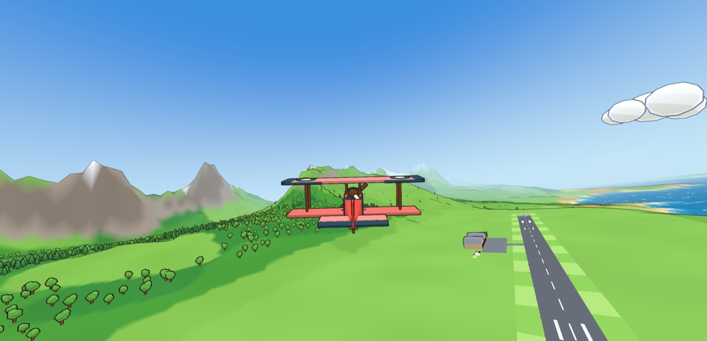

# Baron

A cartoon biplane game for the browser: take off, fly and land over a procedurally generated world. It is built with TypeScript, three.js (WebGL 2) and Vite.

The design is in `design.dai`, the build plan in `plan.dai`, and the build log in `progress.dai`. Open them in DAI Studio.

https://baron.by.dai.studio

## Run

```sh
npm install
npm run dev      # http://localhost:5288
npm test         # vitest: world determinism, flight model, every hangar loadout
npm run build    # static build in dist/ (host on any CDN)
```

Add `?debug` to the URL to get a live flight-model tuning panel (lil-gui) and a stats overlay.

## Hangar

The game opens on a main menu over a flyover of the world. Press **Hangar** (or H) to build your plane: **Plane** (Biplane with a wooden prop, Turboprop with a turbo prop, or Jet), **Paint** (8 colours) and **Wheels** (Hard, Medium, Soft). The plane and wheels change how it flies; the stat bars show the trade-offs. Use ← → to pick a category, ↑ ↓ to choose, then go back to the main menu (Esc) and press FLY! Your choice is saved, and `?plane=jet.scarlet.soft` (style.paint.wheels) picks one from the URL. Every airfield has a 900 m asphalt runway with grass shoulders, so every combination can take off and land.

## Cross-country

Pick **Mission → Cross-country** on the main menu to fly from your home field to another airfield. A **Flight plan** panel appears beside the menu with the destination (◀ ▶, or ← → on the keyboard) and a map of the route, its length, rough flight time and highest altitude. The route is planned for your plane's turning circle: a climb-out from the home runway, a smooth curve that clears the hills, and a straight-in final on a 4° glide slope, landing into the wind unless that means a long detour or the terrain blocks the approach.

In the air, transparent white arrows mark the path ahead. If you stray more than about 150 m from it, a **PATH** marker (or an arrow at the screen edge) shows where to rejoin. The destination is the gold caret on the compass and the gold strip on the minimap. Land at the destination to finish. Your medal depends on the landing grade and how much of the flight you spent on the path (75% for gold, 50% for silver), and records are kept per world and destination.

## Flaps

Flaps add lift so you can fly slower: **T/O** (half) shortens the take-off run, and **LAND** (full) lowers the stall speed by about 15% and adds drag, so the approach is slower and steeper and the landing roll shorter. Press F for more flap and V for less. The flaps take a second or two to move, and above the plane's flap speed (about 1.6× its clean stall speed) the airflow blows them back; the HUD shows **FLAPS — TOO FAST!** until you slow down.

## Controls

| Action | Keys |
| --- | --- |
| Pitch | W / S or ↑ / ↓ (S pulls up) |
| Roll | A / D or ← / → |
| Rudder | Q / E |
| Throttle | Shift / Ctrl, or 1–9 and 0 (full) |
| Flaps | F more / V less (UP, T/O, LAND); gamepad d-pad ↓ / ↑ |
| Brakes | B |
| Camera | C (chase / cockpit) |
| Mouse stick | M toggles |
| Bail out | X |
| Hangar (main menu) | H |
| Cross-country destination (main menu) | ← / → |
| Pause / restart | Esc or P / R |
| Gamepad | Left stick to fly, right stick X for rudder and Y for throttle |

## Code map

| Folder | Contents | Design section |
| --- | --- | --- |
| `src/core` | fixed 120 Hz loop, input, settings and saves | §6 |
| `src/world` | seeded RNG and noise, terrain, biomes, airfields, chunk workers with LOD rings, props, clouds | §4 |
| `src/render` | toon material with rim light, inverted-hull outlines, depth-edge ink pass + FXAA, sky, water | §5 |
| `src/plane` | hangar loadouts and spec composer, procedural plane meshes, flight model, assist helpers | §3, §8 |
| `src/fx` | instanced cartoon particles, POW! bursts | §5 |
| `src/ui`, `src/audio` | canvas HUD and minimap, menus, hangar screen, synthesised Web Audio | §3, §8 |
| `src/game` | game state machine (core loop §2), camera rig | §2, §6 |

All art and audio are generated in code. There are no external asset files.

## License

BSD 2-Clause License. Copyright (c) 2026, DAI Studio. See [LICENSE](LICENSE).
